<picture>
  <source media="(prefers-color-scheme: dark)" srcset="https://raw.githubusercontent.com/tingkart/tingkart/main/dark_mode.svg">
  
</picture>

<a href="https://allemannsdata.com"><picture><source media="(prefers-color-scheme: dark)" srcset="https://raw.githubusercontent.com/tingkart/tingkart/main/link_allemannsdata_dark.svg"></picture></a><a href="https://www.linkedin.com/in/YOUR-LINKEDIN-SLUG/"><picture><source media="(prefers-color-scheme: dark)" srcset="https://raw.githubusercontent.com/tingkart/tingkart/main/link_linkedin_dark.svg"></picture></a>

<picture>
  <source media="(prefers-color-scheme: dark)" srcset="https://raw.githubusercontent.com/tingkart/tingkart/output/pacman-contribution-graph-dark.svg">
  
</picture>
