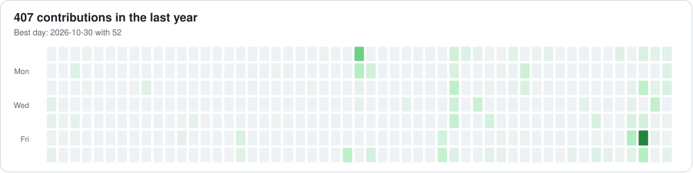
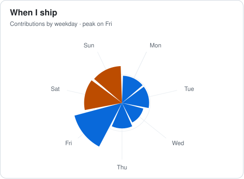
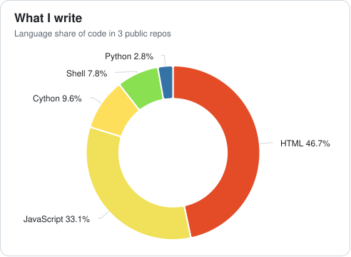
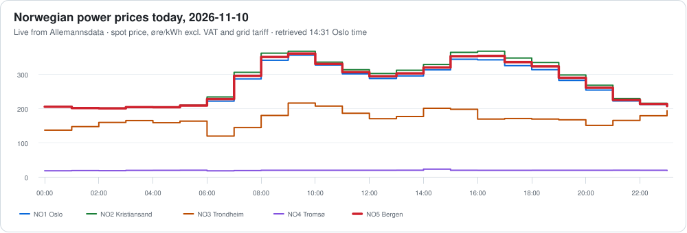

<picture><source media="(prefers-color-scheme: dark)" srcset="https://raw.githubusercontent.com/tingkart/tingkart/main/generated/neofetch_dark.svg"></picture>

<a href="https://allemannsdata.com"><picture><source media="(prefers-color-scheme: dark)" srcset="https://raw.githubusercontent.com/tingkart/tingkart/main/link_allemannsdata_dark.svg"></picture></a><a href="https://www.linkedin.com/in/sysfrog/"><picture><source media="(prefers-color-scheme: dark)" srcset="https://raw.githubusercontent.com/tingkart/tingkart/main/link_linkedin_dark.svg"></picture></a>

<picture><source media="(prefers-color-scheme: dark)" srcset="https://raw.githubusercontent.com/tingkart/tingkart/main/generated/heatmap_dark.svg"></picture>

<picture><source media="(prefers-color-scheme: dark)" srcset="https://raw.githubusercontent.com/tingkart/tingkart/main/generated/weekday_dark.svg"></picture> <picture><source media="(prefers-color-scheme: dark)" srcset="https://raw.githubusercontent.com/tingkart/tingkart/main/generated/languages_dark.svg"></picture>

<picture><source media="(prefers-color-scheme: dark)" srcset="https://raw.githubusercontent.com/tingkart/tingkart/main/generated/power_dark.svg"></picture>

<picture><source media="(prefers-color-scheme: dark)" srcset="https://raw.githubusercontent.com/tingkart/tingkart/output/pacman-contribution-graph-dark.svg"></picture>

Charts made with <a href="https://www.highcharts.com">Highcharts</a>, rebuilt every morning by a GitHub Action. Power prices: <a href="https://allemannsdata.com">Allemannsdata</a>.
